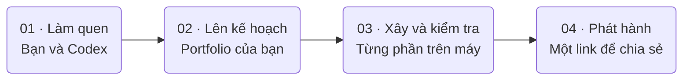
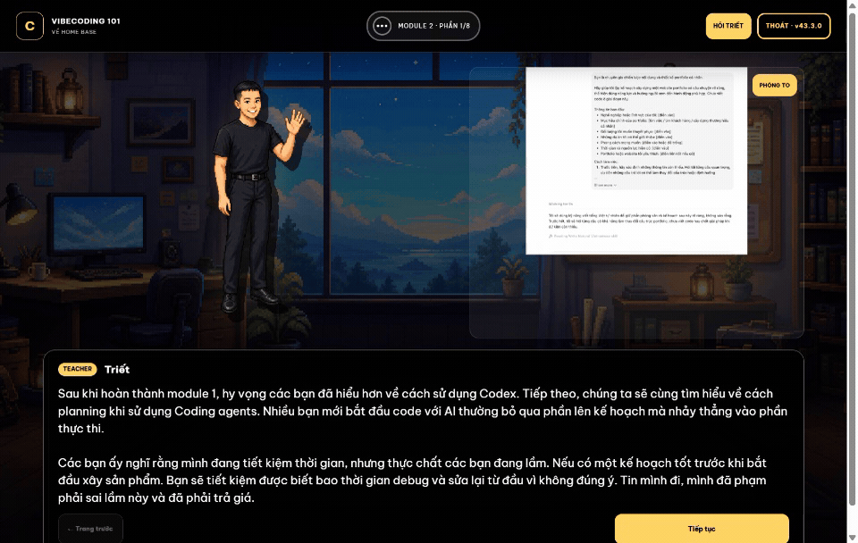
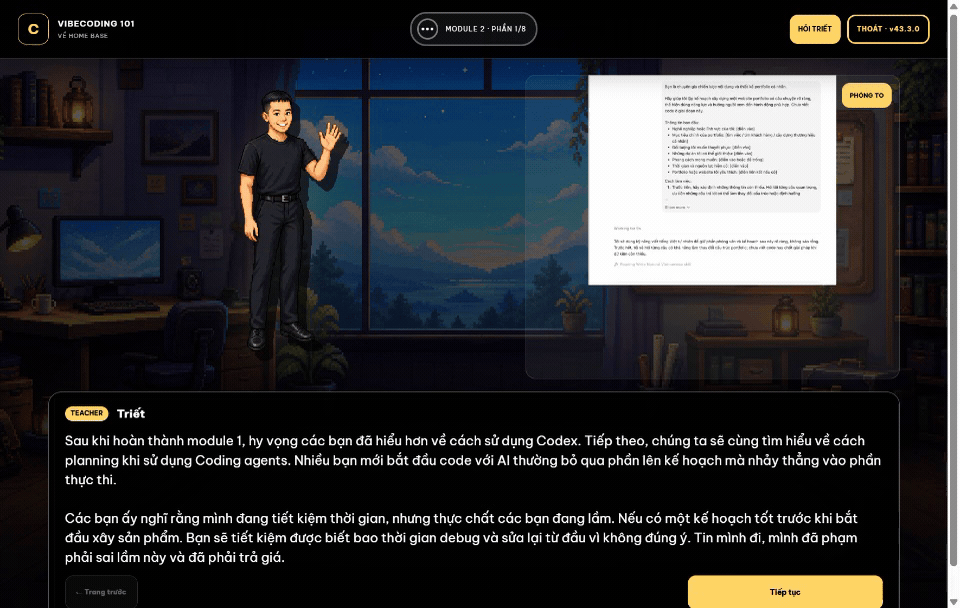

# Vibecoding 101

> Cùng Codex xây một portfolio của riêng bạn — và học cách biến ý tưởng thành
> phần mềm có thể chạy, kiểm tra và chia sẻ.

Chào mừng bạn đến với Vibecoding 101. Nếu bạn muốn tự làm một website nhưng
chưa biết bắt đầu từ đâu, mình sẽ cùng bạn đi từng bước: từ ý tưởng ban đầu,
lên kế hoạch, xây thử trên máy cho đến khi có một đường link để gửi cho người
khác xem. Bạn không cần biết lập trình trước khi bắt đầu.

Trong khóa học, bạn sẽ làm việc cùng **Codex**, một coding agent có thể đọc
dự án, viết code và chạy các bước kiểm tra theo yêu cầu của bạn. Bạn mang đến
câu chuyện, trải nghiệm và ý tưởng cho portfolio; Codex giúp thực hiện phần
kỹ thuật. Bạn sẽ học cách giao việc rõ ràng, xem kết quả và quyết định bước
tiếp theo.

Portfolio là nơi để bắt đầu. Điều bạn mang theo sau khóa học còn là một cách
làm việc có thể áp dụng khi muốn xây một công cụ hay ứng dụng nhỏ khác.

[Xem cách thiết lập và bắt đầu học](#thiết-lập-và-bắt-đầu-học)

> [!NOTE]
> **Khóa học đang trong giai đoạn hoàn thiện.** Hiện có phần giới thiệu và bốn
> module, cùng trình khởi động cho Windows và macOS. Luồng học trên Windows đã
> được kiểm tra tự động; trải nghiệm trên máy Mac thật và với người mới học
> vẫn cần được kiểm chứng thêm.

## Từ ý tưởng đến portfolio của bạn



Mỗi module có phần giải thích, ví dụ và bài thực hành để bạn thử ngay điều
vừa học.

Các GIF bên dưới được ghi trực tiếp từ Course Companion trong một hồ sơ
minh họa riêng. Phản hồi hỏi đáp và kết quả review được mô phỏng để giới
thiệu cách dùng, không phải bài nộp của người học thật.

### Module 1 — Làm quen với Codex

Bạn sẽ hiểu cách giao việc, chọn model, nhận biết quyền hành động, dùng
`AGENTS.md` và Skills; kiểm tra thiết lập Codex trước khi thực hành tiếp.
Khi Codex đề xuất một thao tác, bạn biết mình cần xem gì trước khi đồng ý.


### Module 2 — Lên kế hoạch portfolio

Bạn chọn người xem, sắp xếp tư liệu, tìm hướng thiết kế và cùng Codex viết
tài liệu yêu cầu sản phẩm (PRD) cùng kế hoạch triển khai. Bạn duyệt kế hoạch
trước khi xây, để cả hai cùng hiểu portfolio cần làm được những gì.



### Module 3 — Xây và kiểm chứng

Từ kế hoạch đã duyệt, bạn xây từng phần, mở website trên máy để xem và đề
xuất cải thiện. Khi gặp lỗi, bạn luyện cách mô tả điều đang xảy ra, cùng
Codex tìm nguyên nhân rồi kiểm tra lại. Bạn cũng làm quen với Git và GitHub
để lưu lại các phiên bản.


### Module 4 — Đưa portfolio lên mạng

Bạn cùng Codex phát hành lên Vercel, kiểm tra website ở kích thước máy tính
và điện thoại, rồi xác nhận đường link sẵn sàng để chia sẻ. Phần giải thích
về hosting và video hướng dẫn giúp bạn hình dung bước này trước khi tự làm.


Riêng Module 2, bạn sẽ hoàn thiện một gói gồm **năm tài liệu**: bản mô tả
portfolio, danh sách tư liệu và bằng chứng, định hướng tham chiếu, PRD và kế
hoạch triển khai. Bạn chưa cần xây hay xuất bản website ở bước này. Từ Module
2 đến Module 4, bạn tiếp tục dùng cùng thư mục portfolio và cùng cuộc trò
chuyện công việc (task) trong Codex để giữ liền mạch kế hoạch và quá trình làm.

## Bạn sẽ học như thế nào?

**Course Companion** là ứng dụng đồng hành, nơi bạn đọc bài học, xem ví dụ và
theo dõi tiến độ. Khi đến phần **Practice** (thực hành), bạn chuyển sang task
Codex được liên kết với bài để làm việc trên dự án của mình.

Bạn có thể hỏi Teacher khi học lý thuyết. Trong Practice, hãy làm việc trực
tiếp với Codex; bảng hướng dẫn, checklist và nút **Cần gợi ý?** giúp bạn tìm
bước tiếp theo khi cần. Hướng dẫn Practice ở Module 1 có thể tạm dừng, tiếp
tục hoặc xem lại.



Khi sẵn sàng, bạn nộp kết quả để Teacher xem xét bằng chứng. Nếu còn thiếu,
bạn sẽ nhận phản hồi về phần cần bổ sung và có thể sửa rồi nộp lại. Nếu đạt,
bạn quay về bài học để tiếp tục. Bạn vẫn là người duyệt kế hoạch, chấp nhận
website và quyết định nội dung nào được đưa lên mạng.


Bạn có thể dừng giữa chừng và quay lại sau. Course Companion lưu tiến độ trên
máy để bạn tiếp tục từ bước đang học.

## Bạn sẽ học được gì?

- **Hiểu trước khi sửa.** Nhờ Codex giải thích dự án, thuật ngữ và đề xuất theo
  cách bạn hiểu được trước khi yêu cầu thay đổi.
- **Giao việc có thể kiểm chứng.** Nêu mục tiêu, bối cảnh, phạm vi, ràng buộc và
  dấu hiệu hoàn thành.
- **Giữ quyền quyết định.** Xem kế hoạch, nhận diện rủi ro và chỉ cho phép hành
  động khi đã hiểu tác động.
- **Kiểm tra bằng chứng.** Tự xem website, đối chiếu với yêu cầu và nhờ Codex
  giải thích kết quả kiểm tra để biết phần nào đã đạt, phần nào còn thiếu.
- **Sửa sai có kiểm soát.** Chẩn đoán từ bằng chứng và chạy lại đúng phần bị lỗi
  mà không làm mất công việc đã đạt.
- **Dùng lại cách làm.** Mang quy trình từ portfolio sang một dự án nhỏ khác
  của bạn.

## Khóa học này phù hợp với ai?

Khóa học dành cho bạn nếu muốn có một nơi giới thiệu bản thân, dự án hoặc
công việc của mình, nhưng chưa có nền tảng kỹ thuật. Bạn có thể đang đi học,
đi làm, làm freelance, sáng tạo nội dung hoặc chuẩn bị cho một hướng đi mới.

Bạn chưa cần có một bộ dự án thật đầy đủ. Bài tập cá nhân hoặc ý tưởng thử
nghiệm cũng có thể là điểm bắt đầu, miễn là bạn mô tả rõ đâu là trải nghiệm
thật, đâu là concept đang khám phá.

Chỉ cần sẵn lòng thử từng bước nhỏ, đặt câu hỏi khi chưa hiểu và tự xem lại
kết quả cùng Codex.

## Trước khi bắt đầu

Bạn không cần biết lập trình, Git hay dòng lệnh trước khi học. Chỉ cần biết thao tác máy tính cơ bản như tạo thư mục, mở và lưu tệp, cài ứng dụng.

Để học và làm bài thực hành, bạn cần:

- Ứng dụng ChatGPT desktop phiên bản mới có Codex, đã đăng nhập bằng tài khoản ChatGPT của bạn. Khóa học dùng Codex để thực hành trên các tệp và dự án trong máy.
- **Khuyến nghị dùng ChatGPT Plus hoặc cao hơn để có trải nghiệm học tốt nhất.**

Để tải và mở Course Companion, ứng dụng học của khóa này, bạn cần chuẩn bị thêm:

- **Git**, công cụ dùng để tải khóa học và lưu các phiên bản dự án.
- **Node.js 22 trở lên**, phần mềm cần để chạy ứng dụng học. Trên macOS, bạn cần cài trước. Trên Windows, trình khởi động sẽ đề xuất cài nếu còn thiếu và hỏi bạn trước khi thực hiện.

Bạn chưa cần biết cách sử dụng những công cụ này. Hãy nhờ agent giúp bạn làm theo phần hướng dẫn thiết lập bên dưới.

## Thiết lập và bắt đầu học

### Bước 1 — Tải và khởi động khóa học

Chọn hướng dẫn phù hợp với máy của bạn, rồi chạy lần lượt các lệnh bên dưới.

#### Windows

Mở **Command Prompt** hoặc **PowerShell** trong thư mục bạn muốn lưu khóa học.
Chạy lần lượt:

```bat
git clone https://github.com/DiligentPenguinn/codex-content-creator-course.git
cd codex-content-creator-course
.\start-course.cmd
```

#### macOS

Mở **Terminal** trong thư mục bạn muốn lưu khóa học. Chạy lần lượt:

```bash
git clone https://github.com/DiligentPenguinn/codex-content-creator-course.git
cd codex-content-creator-course
./start-course.command
```

Sau khi tải repository, bạn cũng có thể nhấp đúp `start-course.command` trong
Finder.

### Bước 2 — Xem và xác nhận phần chuẩn bị

Sau khi chạy lệnh, bạn sẽ nhận lời chào và phần giải thích ngắn về quá trình
chuẩn bị. Trình khởi động kiểm tra các công cụ cần thiết và cho biết phần nào
còn thiếu.

Nếu cần cài thêm, hãy đọc lệnh và mục đích được hiển thị. Khi thấy phù hợp,
bạn xác nhận để trình khởi động thực hiện. **Không có gì được cài nếu bạn
chưa đồng ý.** Nếu mọi thứ đã sẵn sàng, trình khởi động sẽ mở Course Companion
để bạn tiếp tục.

Bạn có thể từ chối cài đặt. Trình khởi động sẽ dừng và giải thích bước tiếp theo
bạn có thể tự thực hiện.

### Bước 3 — Bắt đầu học trong Course Companion

Khi Course Companion mở, bạn bắt đầu từ phần giới thiệu nếu đây là lần đầu
học. Nếu đã học trước đó, ứng dụng khôi phục tiến độ đã lưu trên máy và đưa
bạn về đúng bước đang học.

Bạn chỉ cần làm theo hướng dẫn trong bài. Khi đến phần Practice, khóa học sẽ
hướng dẫn bạn chuyển sang Codex để thực hành.

## Tài khoản và tiến độ

- Luồng thiết lập Windows dùng trang đăng nhập ChatGPT chính thức của Codex và
  không đọc hoặc lưu mật khẩu hay token đăng nhập của bạn.
- Course Companion đọc bằng chứng có giới hạn từ đúng task Practice đã liên
  kết và các file liên quan trong thư mục thực hành. Teacher hướng dẫn và
  nhận xét; bạn làm việc với Codex để thay đổi dự án.
- Cấu hình không chứa bí mật và tiến độ học được lưu trên máy của bạn.
- Khi mở lại, ứng dụng kiểm tra bản lưu và đưa bạn về đúng bước đang học.
- Một bản tải khóa học mới trên cùng máy và tài khoản hệ điều hành vẫn dùng
  tiến độ đã lưu trước đó. Tải lại repository không đặt lại hồ sơ học tập.

## Khi cần trợ giúp

Với hướng dẫn khởi động, kiểm chứng Practice và các giới hạn hiện tại trên
Windows và macOS, xem [hướng dẫn Course Companion](course-companion/README.md).

## For contributors

The links below are for people developing the course itself. Learners do not
need to read them to begin.

<details>
<summary>Open contributor resources and authority map</summary>

### Current authority

- [Pilot workspace](pilot-workspace/START_HERE.md) is the runnable private-course
  authority. Root course skills delegate to the skills inside this workspace.
- [Course Companion](course-companion/README.md) is the implemented desktop-app
  package shared by Windows and macOS. Normal operation uses the local Codex App
  Server; simulated responses and evidence belong to explicitly labelled tests.
- [Portfolio curriculum](docs/planning/portfolio-course-v1/README.md) and the
  [implementation ledger](docs/planning/portfolio-course-implementation-plan.md)
  record the current public-course direction, implementation evidence and open
  acceptance gates. Automated checks do not establish beginner-pilot acceptance.
- [Practice and Teacher handoff](docs/planning/practice-teacher-handoff-triet-v3-2026-09-12.md)
  and the [later merge handoff](docs/planning/practice-courseapp-merge-handoff-2026-10-29.md)
  explain the integration boundaries and the Modules 2–4 portfolio journey.
- [ContentPilot learner starter](starters/contentpilot/README.md) is the
  preserved application baseline for ContentPilot work; the current learner-facing
  project in Course Companion is a portfolio built in a separate learner folder.
- [ContentPilot planning handoff](docs/planning/content-automation-course-handoff.md)
  preserves the earlier content-automation direction for reference.
- [UI, UX, and interaction review](docs/planning/ui-ux-interaction-review-index.md)
  maps current behavior, planned behavior, and historical references.
- [Interactive team workload map](docs/planning/team-workload-map.html) records
  the current collaboration boundaries.
- [README media capture notes](docs/assets/readme/README.md) document the original
  GIFs, static screenshots, demo boundaries and copywriting reference.

From the repository root, `$start-course-lesson` and `$course-teacher` delegate
to the skills inside `pilot-workspace/`. They do not fall back to historical
prototype curricula.

### Historical references

- [Windows startup prototype](prototypes/app-startup-electron-mock/README.md)
- [Windows startup mock technical design](docs/superpowers/specs/2026-07-30-electron-startup-mock-design.md)
- [MVP 0.5 pedagogy kernel](prototypes/mvp-0.5-pedagogy-kernel/README.vi.md)
- [MVP 1 course repository prototype](prototypes/mvp-1-course-repo/README.vi.md)
- [MVP 2 workflow prototype](prototypes/mvp-2-content-workflow-prototype/README.md)
- [MVP 3 course experience visual prototype](prototypes/mvp-3-course-experience-companion/README.md)
- `codex_content_creator_course_plan_v8.html`, the original 13-module strategy

</details>
