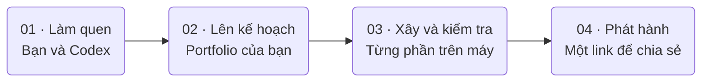
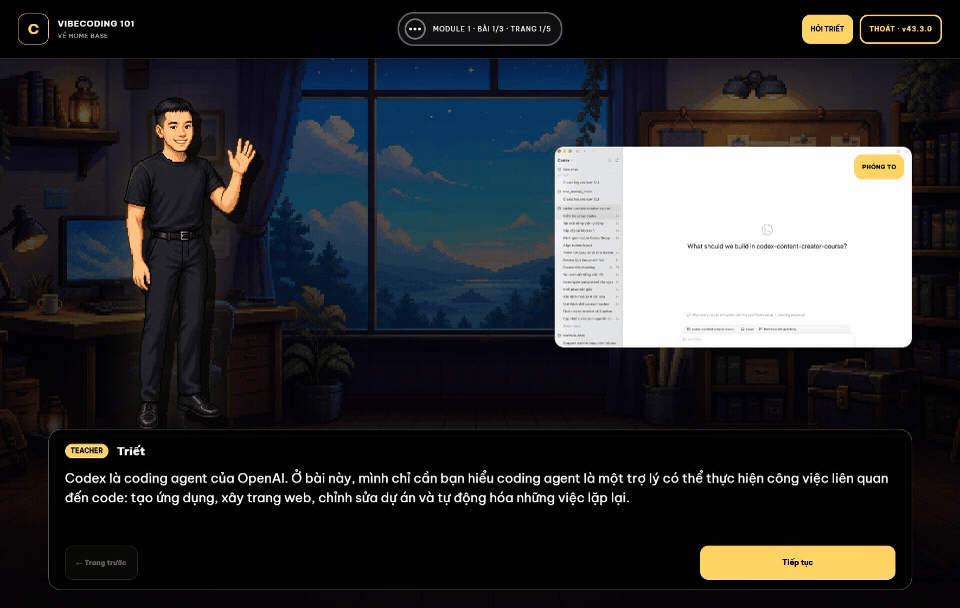
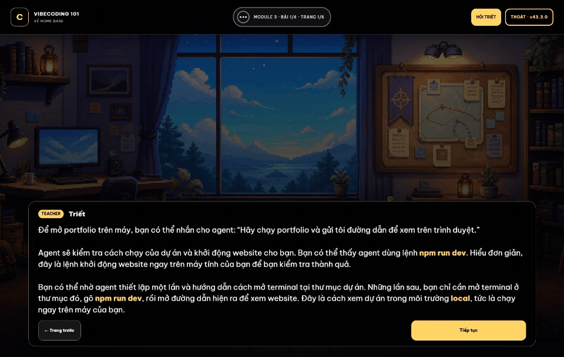
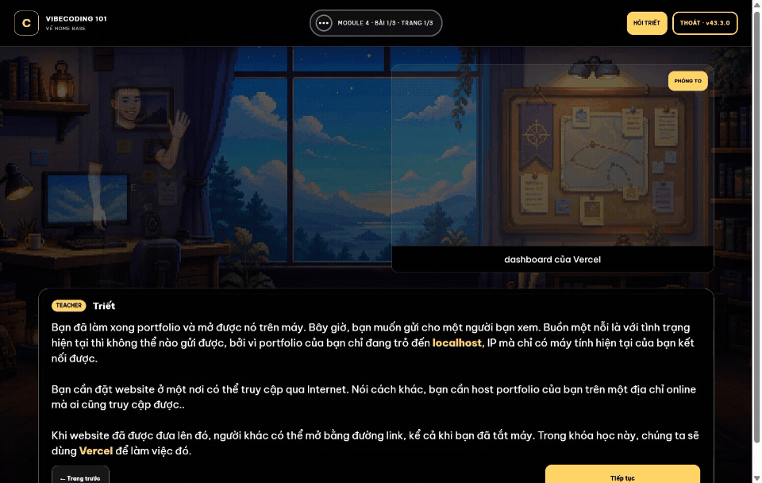
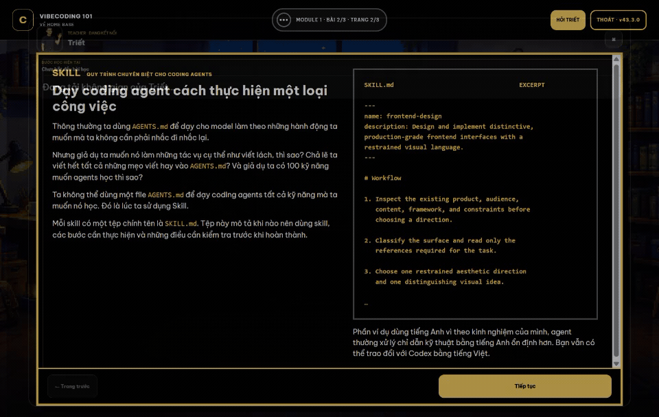
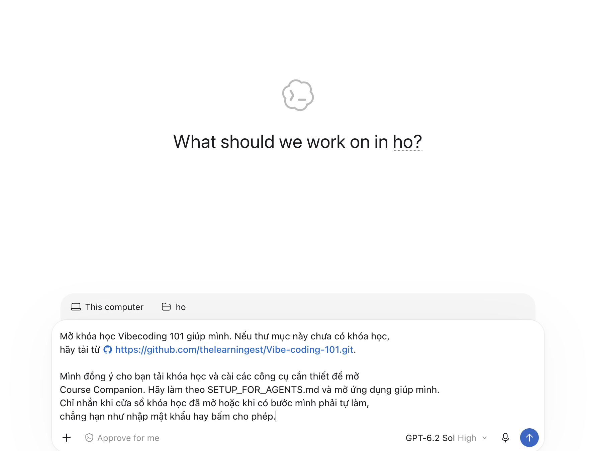
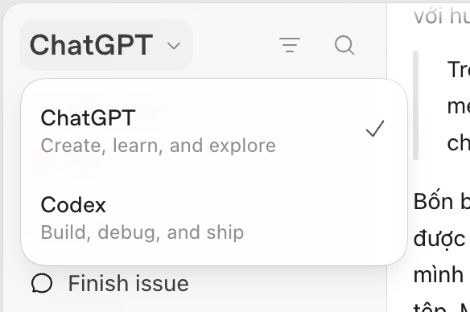
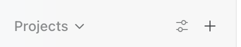
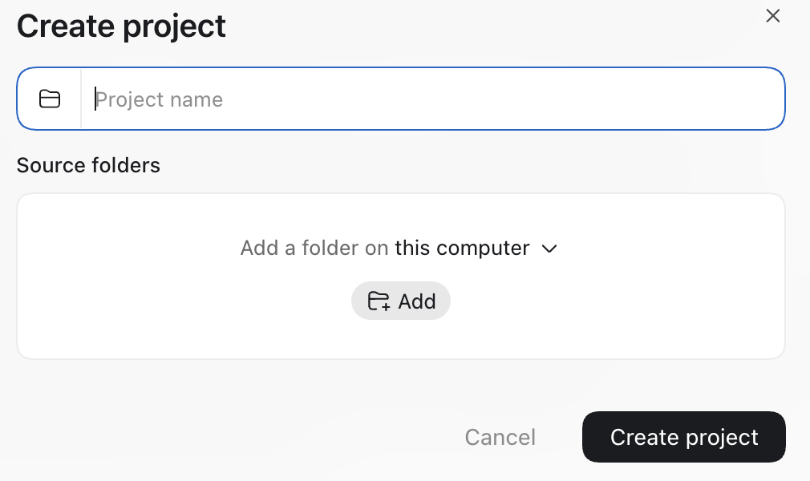
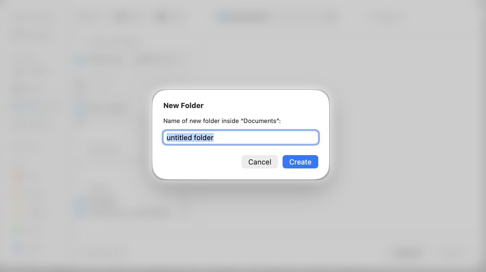

# Vibecoding 101

> Dùng Codex để học Codex
> Khoá học vibecoding cho người non-technical


Trong khóa học, bạn sẽ làm việc cùng **Codex**, một coding agent từ OpenAI. Nếu bạn đã quyết định xem qua khoá học này, mình tin rằng mình không cần thuyết phục bạn về lợi ích của việc dùng Codex thay vì chỉ dùng chế độ chat của chatGPT. 
Bạn mang đến câu chuyện, trải nghiệm và ý tưởng cho portfolio; Codex giúp thực hiện phần
kỹ thuật. Bạn sẽ học cách giao việc rõ ràng, xem kết quả và quyết định bước
tiếp theo.

Portfolio là nơi để bắt đầu. Điều bạn mang theo sau khóa học còn là một cách
làm việc có thể áp dụng khi muốn xây một công cụ hay ứng dụng nhỏ khác.

[Xem cách thiết lập và bắt đầu học](#thiết-lập-và-bắt-đầu-học)

> [!NOTE]
> **Khóa học đang trong giai đoạn hoàn thiện.** Hiện có phần giới thiệu và bốn
> module, cùng trình khởi động cho Windows và macOS. Luồng học trên Windows đã
> được kiểm tra tự động; trải nghiệm trên máy Mac thật và với người mới học
> vẫn cần được kiểm chứng thêm.

## Mục lục

- [Từ ý tưởng đến portfolio của bạn](#từ-ý-tưởng-đến-portfolio-của-bạn)
- [Bạn sẽ học như thế nào?](#bạn-sẽ-học-như-thế-nào)
- [Bạn sẽ học được gì?](#bạn-sẽ-học-được-gì)
- [Khóa học này phù hợp với ai?](#khóa-học-này-phù-hợp-với-ai)
- [Trước khi bắt đầu](#trước-khi-bắt-đầu)
- [Thiết lập và bắt đầu học](#thiết-lập-và-bắt-đầu-học)
  - [Bước 1 — Tải và khởi động khóa học](#bước-1--tải-và-khởi-động-khóa-học)
  - [Bước 2 — Xem và xác nhận phần chuẩn bị](#bước-2--xem-và-xác-nhận-phần-chuẩn-bị)
  - [Bước 3 — Bắt đầu học](#bước-3--bắt-đầu-học)
- [Tài khoản và tiến độ](#tài-khoản-và-tiến-độ)
- [Khi cần trợ giúp](#khi-cần-trợ-giúp)

## Từ ý tưởng đến portfolio của bạn



Mỗi module có phần giải thích, ví dụ và bài thực hành để bạn thử ngay điều
vừa học.

Các GIF bên dưới được ghi trực tiếp từ khóa học trong một hồ sơ
minh họa riêng. Phản hồi hỏi đáp và kết quả review được mô phỏng để giới
thiệu cách dùng, không phải bài nộp của người học thật.

### Module 1 — Làm quen với Codex

Bạn sẽ hiểu cách giao việc, chọn model, nhận biết quyền hành động, dùng
`AGENTS.md` và Skills; kiểm tra thiết lập Codex trước khi thực hành tiếp.
Khi Codex đề xuất một thao tác, bạn biết mình cần xem gì trước khi đồng ý.



### Module 2 — Lên kế hoạch portfolio

Bạn chọn người xem, sắp xếp tư liệu, tìm hướng thiết kế và cùng Codex viết
tài liệu yêu cầu sản phẩm (PRD) cùng kế hoạch triển khai. Bạn duyệt kế hoạch
trước khi xây, để cả hai cùng hiểu portfolio cần làm được những gì.


### Module 3 — Xây và kiểm chứng

Từ kế hoạch đã duyệt, bạn xây từng phần, mở website trên máy để xem và đề
xuất cải thiện. Khi gặp lỗi, bạn luyện cách mô tả điều đang xảy ra, cùng
Codex tìm nguyên nhân rồi kiểm tra lại. Bạn cũng làm quen với Git và GitHub
để lưu lại các phiên bản.



### Module 4 — Đưa portfolio lên mạng

Bạn cùng Codex phát hành lên Vercel, kiểm tra website ở kích thước máy tính
và điện thoại, rồi xác nhận đường link sẵn sàng để chia sẻ. Phần giải thích
về hosting và video hướng dẫn giúp bạn hình dung bước này trước khi tự làm.



Riêng Module 2, bạn sẽ hoàn thiện một gói gồm **năm tài liệu**: bản mô tả
portfolio, danh sách tư liệu và bằng chứng, định hướng tham chiếu, PRD và kế
hoạch triển khai. Bạn chưa cần xây hay xuất bản website ở bước này. Từ Module
2 đến Module 4, bạn tiếp tục dùng cùng thư mục portfolio và cùng cuộc trò
chuyện công việc (task) trong Codex để giữ liền mạch kế hoạch và quá trình làm.

## Bạn sẽ học như thế nào?

**Khóa học** chạy trong một ứng dụng đồng hành, nơi bạn đọc bài học, xem ví dụ
và theo dõi tiến độ. Khi đến phần **Practice** (thực hành), bạn chuyển sang task
Codex được liên kết với bài để làm việc trên dự án của mình.

Bạn có thể hỏi Teacher khi học lý thuyết. Trong Practice, hãy làm việc trực
tiếp với Codex; bảng hướng dẫn, checklist và nút **Cần gợi ý?** giúp bạn tìm
bước tiếp theo khi cần. Hướng dẫn Practice ở Module 1 có thể tạm dừng, tiếp
tục hoặc xem lại.


Khi sẵn sàng, bạn nộp kết quả để Teacher xem xét bằng chứng. Nếu còn thiếu,
bạn sẽ nhận phản hồi về phần cần bổ sung và có thể sửa rồi nộp lại. Nếu đạt,
bạn quay về bài học để tiếp tục. Bạn vẫn là người duyệt kế hoạch, chấp nhận
website và quyết định nội dung nào được đưa lên mạng.



Bạn có thể dừng giữa chừng và quay lại sau. Khóa học lưu tiến độ trên máy để
bạn tiếp tục từ bước đang học.

## Bạn sẽ học được gì?

- **Hiểu trước khi sửa.** Nhờ Codex giải thích dự án, thuật ngữ và đề xuất theo
  cách bạn hiểu được trước khi yêu cầu thay đổi.
- **Giao việc có thể kiểm chứng.** Nêu mục tiêu, bối cảnh, phạm vi, ràng buộc và
  dấu hiệu hoàn thành.
- **Giữ quyền quyết định.** Xem kế hoạch, nhận diện rủi ro và chỉ cho phép hành
  động khi đã hiểu tác động.
- **Kiểm tra bằng chứng.** Tự xem website, đối chiếu với yêu cầu và nhờ Codex
  giải thích kết quả kiểm tra để biết phần nào đã đạt, phần nào còn thiếu.
- **Sửa sai có kiểm soát.** Chẩn đoán từ bằng chứng và chạy lại đúng phần bị lỗi
  mà không làm mất công việc đã đạt.
- **Dùng lại cách làm.** Mang quy trình từ portfolio sang một dự án nhỏ khác
  của bạn.

## Khóa học này phù hợp với ai?

Khóa học dành cho bạn nếu muốn có một nơi giới thiệu bản thân, dự án hoặc
công việc của mình, nhưng chưa có nền tảng kỹ thuật. Bạn có thể đang đi học,
đi làm, làm freelance, sáng tạo nội dung hoặc chuẩn bị cho một hướng đi mới.

Bạn chưa cần có một bộ dự án thật đầy đủ. Bài tập cá nhân hoặc ý tưởng thử
nghiệm cũng có thể là điểm bắt đầu, miễn là bạn mô tả rõ đâu là trải nghiệm
thật, đâu là concept đang khám phá.

Chỉ cần sẵn lòng thử từng bước nhỏ, đặt câu hỏi khi chưa hiểu và tự xem lại
kết quả cùng Codex.

## Trước khi bắt đầu

Bạn không cần biết lập trình hay từng dùng công cụ kỹ thuật nào trước khi học. Chỉ cần biết thao tác máy tính cơ bản như tạo thư mục, mở và lưu tệp, cài ứng dụng.

Để học và làm bài thực hành, bạn cần:

- Ứng dụng ChatGPT desktop phiên bản mới có Codex, đã đăng nhập bằng tài khoản ChatGPT của bạn. Khóa học dùng Codex để thực hành trên các tệp và dự án trong máy.
- **Khuyến nghị dùng ChatGPT Plus hoặc cao hơn để có trải nghiệm học tốt nhất.**

Nếu máy còn thiếu phần mềm cần để mở khóa học, agent sẽ giúp bạn cài.

<sub>[Khóa học sẽ cài những gì? (không bắt buộc, đọc nếu bạn tò mò)](docs/khoa-hoc-se-cai-gi.md)</sub>

Bạn chưa cần biết cách sử dụng những công cụ này. Hãy nhờ agent giúp bạn làm theo phần hướng dẫn thiết lập bên dưới.

## Thiết lập và bắt đầu học

### Bước 1 — Tải và khởi động khóa học

Tạo một thư mục trống, mở thư mục đó trong Codex, rồi dán
đoạn sau vào một task mới.

```text
Mở khóa học Vibecoding 101 giúp mình. Nếu thư mục này chưa có khóa học,
hãy tải từ https://github.com/thelearningest/Vibe-coding-101.git.

Mình đồng ý cho bạn tải khóa học và cài các công cụ cần thiết để mở
Course Companion. Hãy làm theo SETUP_FOR_AGENTS.md và mở ứng dụng giúp mình.
Chỉ nhắn khi cửa sổ khóa học đã mở hoặc khi có bước mình phải tự làm,
chẳng hạn như nhập mật khẩu hay bấm cho phép.
```



Nếu chưa biết cách mở thư mục trong Codex, bạn làm theo năm bước sau:

1. Trong ứng dụng ChatGPT, bấm **ChatGPT** ở góc trên bên trái, rồi chọn **Codex**.

   

2. Trong Codex, bấm dấu **+** cạnh chữ **Projects** ở thanh bên trái.

   

3. Hộp **Create project** hiện ra. Ở mục **Source folders**, bấm **Add**.

   

4. Cửa sổ chọn thư mục mở ra. Chọn **Documents** ở cột bên trái, bấm
   **New Folder**, đặt tên `vibecoding-101`, bấm **Create**, rồi bấm **Open**.

   

5. Kiểm tra ô **Project name**. Nếu ô còn trống, nhập `vibecoding-101`. Bấm
   **Create project**.

Ảnh được chụp trên macOS. Trên Windows, các nút có tên tương tự.

### Bước 2 — Trước khi bắt đầu khoá học

Gửi tin nhắn xong, bạn chỉ cần chờ app khoá học mở. Nếu máy yêu cầu nhập mật khẩu hoặc bấm cho phép, Codex sẽ hướng dẫn bạn. Lần sau, mở lại thư mục khóa học trong Codex và nhắn “Mở khóa học giúp mình”.


### Bước 3 — Bắt đầu học

Bạn sẽ thấy nội dung của khoá học hiện ra sau khi coding agents đã tải các công cụ cần thiết. Việc của bạn sau đó chỉ đơn giản là tận hưởng khoá học!


