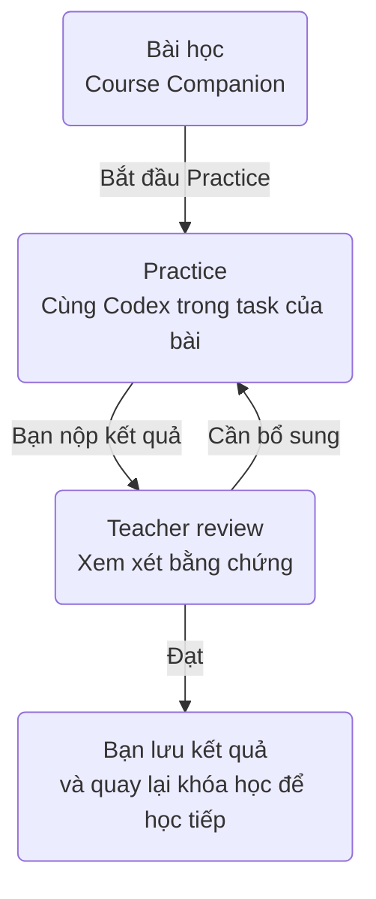

# Course Companion — Hướng dẫn bắt đầu

Chào bạn! Course Companion là nơi bạn học Vibecoding 101, xem ví dụ và theo
dõi hành trình xây portfolio của mình. Khi đến phần thực hành, bạn sẽ làm
việc cùng Codex, rồi quay về đây để xem lại kết quả và học tiếp.

Bạn không cần hiểu hết các thuật ngữ kỹ thuật ngay từ đầu. Mình sẽ cùng bạn
đi qua phần chuẩn bị trước; sau đó, hãy làm theo từng hướng dẫn trong bài.

## Trước khi bắt đầu

Bạn cần:

- máy tính Windows hoặc macOS có kết nối internet;
- Git để tải khóa học về máy;
- tài khoản ChatGPT có quyền dùng Codex và ứng dụng Codex để làm thực hành;
- Node.js 22 trở lên nếu dùng macOS.

Trên Windows, nếu thiếu Node.js, trình khởi động sẽ đề xuất cách cài và hỏi
bạn trước khi thực hiện. Trên macOS, bạn cần cài Node.js trước khi chạy khóa
học.

Nếu chưa có Git hoặc chưa biết tải khóa học ở đâu, bạn có thể bắt đầu từ
[README giới thiệu khóa học](../README.md). Bạn chưa cần tài khoản GitHub
hay Vercel để vào phần giới thiệu; khóa học sẽ dùng đến chúng khi bạn chuẩn
bị phát hành portfolio.

## Thiết lập khóa học

### Bước 1 — Tải khóa học hoặc mở thư mục đã có

**Nếu bạn đã tải khóa học theo README chính**, hãy mở thư mục
`Codex-agentic-coding-course` trên máy. Bạn không cần tải thêm một bản nữa.

**Nếu chưa tải**, mở **Command Prompt** hoặc **PowerShell** trên Windows,
hoặc **Terminal** trên macOS, trong thư mục bạn muốn lưu khóa học. Chạy lần
lượt:

```text
git clone https://github.com/DiligentPenguinn/Codex-agentic-coding-course.git
cd Codex-agentic-coding-course
```

Thư mục dùng để khởi động là thư mục có hai file `start-course.cmd` và
`start-course.command`. Nếu đang ở trong thư mục con `course-companion`,
hãy quay ra thư mục bên ngoài một cấp trước khi làm bước tiếp theo.

### Bước 2 — Chạy lệnh khởi động phù hợp với máy

Mở cửa sổ dòng lệnh tại thư mục khóa học ở bước 1. Nếu vừa chạy hai lệnh
tải khóa học ở trên, bạn đã ở đúng chỗ và có thể dùng luôn cửa sổ đó.

#### Windows

Trong **Command Prompt** hoặc **PowerShell**, chạy:

```bat
.\start-course.cmd
```

#### macOS

Trong **Terminal**, chạy:

```bash
./start-course.command
```

Bạn cũng có thể nhấp đúp `start-course.command` trong Finder.

### Bước 3 — Đọc và xác nhận phần chuẩn bị

Trình khởi động sẽ kiểm tra các công cụ cần thiết. Nếu thiếu phần nào, bạn
sẽ thấy lệnh dự kiến chạy và phần giải thích trước khi được hỏi có muốn
tiếp tục hay không.

Khi thấy câu hỏi có dạng `[y/N]`:

- nếu đồng ý với phần chuẩn bị vừa hiển thị, nhập `y` rồi nhấn **Enter**;
- nếu chưa muốn cài, nhập `n` hoặc chỉ nhấn **Enter** để từ chối.

**Không có gì được cài nếu bạn chưa đồng ý.** Nếu từ chối, trình khởi động
sẽ dừng và cho biết bước bạn có thể tự thực hiện. Bạn có thể chạy lại lệnh
khởi động khi đã sẵn sàng.

Sau khi xác nhận, hãy chờ quá trình chuẩn bị hoàn tất. Course Companion sẽ
tự mở; nếu mọi thứ đã có sẵn, ứng dụng sẽ mở mà không cần cài thêm.

### Bước 4 — Bắt đầu bài học

Nếu đây là lần đầu, bạn sẽ vào phần giới thiệu. Nếu đã học trước đó, ứng
dụng sẽ khôi phục tiến độ trên máy và đưa bạn về bước đang học.

Hãy đọc phần hướng dẫn và tiếp tục theo các nút trong bài. Khi gặp một từ
chưa quen, bạn có thể hỏi Teacher giải thích lại bằng ví dụ gần với mình.

## Course Companion và Codex: mình dùng bên nào?

| Bạn muốn làm gì? | Mở ở đâu? |
| --- | --- |
| Đọc bài học, xem ví dụ và trả lời câu hỏi | Cửa sổ học Course Companion |
| Hỏi về nội dung lý thuyết đang học | Teacher trong bài học |
| Lên kế hoạch, xây hoặc sửa portfolio | Đúng task Codex được liên kết với bài Practice |
| Xem checklist, xin gợi ý hoặc nộp kết quả thực hành | Bảng Practice của Teacher |

Ở đây, **Practice** là bài thực hành; **task Codex** là cuộc trò chuyện công
việc dành cho bài đó. Hãy làm theo hướng dẫn mở hoặc tiếp tục task trong bài
để giữ đúng cuộc trò chuyện đang dùng.

Bạn là người quyết định mục tiêu, duyệt kế hoạch và chấp nhận kết quả.
Teacher giúp giải thích, gợi ý và nhận xét; Codex thực hiện phần kỹ thuật
khi bạn giao việc.

## Khi đến phần Practice

Bạn sẽ đi qua một vòng học và thực hành như thế này:



1. **Đọc mục tiêu.** Xem bạn cần làm gì và kết quả cần đạt trước khi chuyển
   sang Codex.
2. **Mở bài thực hành theo hướng dẫn.** Dùng lựa chọn bắt đầu hoặc tiếp tục
   trong ứng dụng để mở đúng task Codex đã liên kết.
3. **Làm từng phần cùng Codex.** Đọc hướng dẫn và sao chép vào task khi bài
   yêu cầu. Từ Module 2 đến Module 4, giữ cùng thư mục portfolio và cùng task
   để kế hoạch, quá trình xây và phần phát hành nối tiếp nhau.
4. **Xin gợi ý khi cần.** Trong Practice, bạn làm việc trực tiếp với Codex.
   Bảng checklist và nút **Cần gợi ý?** giúp bạn xác định bước tiếp theo.
5. **Nộp kết quả khi sẵn sàng.** Teacher xem xét bằng chứng của bài thực
   hành. Nếu còn thiếu, hãy đọc phản hồi, bổ sung cùng Codex trong task cũ,
   rồi nộp lại.
6. **Lưu kết quả và học tiếp.** Khi Practice được duyệt đạt, chọn
   **Lưu kết quả và quay lại khóa học**. Sau đó, tiếp tục các câu hỏi hoặc
   phần tổng kết mà bài học yêu cầu.

Bạn không cần tự giải quyết mọi vấn đề kỹ thuật. Khi chưa hiểu một đề xuất,
hãy nhờ Codex giải thích bằng lời dễ hiểu và cho biết bạn có thể tự xem kết
quả ở đâu trước khi quyết định.

### Lần đầu thực hành Module 1

Ứng dụng sẽ mở một hướng dẫn để bạn làm quen với vòng thực hành. Bạn có thể
nhấn **Esc** để tạm dừng, chọn **Bỏ qua**, tiếp tục từ thông báo tạm dừng,
hoặc dùng **Xem lại hướng dẫn Practice** để xem lại.

Xem lại hướng dẫn không làm mất bài đang làm hay tiến độ. Hướng dẫn giúp
bạn làm quen; bạn vẫn tự thao tác và nộp kết quả của mình.

### Nếu Teacher thu nhỏ thành một bong bóng

Đó là chế độ đồng hành để bạn có thêm chỗ làm việc trong Codex. Nhấp một lần
để mở cửa sổ xem nhanh, hoặc nhấp đúp để mở Teacher đầy đủ. Bạn cũng có thể
dùng biểu tượng mở rộng trong cửa sổ xem nhanh.

## Dừng và quay lại học sau

Bạn có thể đóng ứng dụng và mở lại bằng lệnh khởi động ở bước 2. Không cần
chạy lại `git clone` hay tạo thư mục khóa học mới.

Course Companion lưu tiến độ trên máy để bạn tiếp tục từ chỗ đang học. Khi
quay lại Practice, hãy dùng lựa chọn tiếp tục để mở đúng task cũ.

Tiến độ này được lưu trong thư mục dữ liệu ứng dụng của hệ điều hành, nên
nếu đổi sang máy khác, bạn không nên mặc định rằng tiến độ sẽ tự xuất hiện.
Nếu ứng dụng đề nghị đặt lại tiến độ, hãy đọc kỹ trước khi xác nhận.

## Nếu bạn gặp vướng mắc

| Bạn đang thấy gì? | Bạn có thể thử gì? |
| --- | --- |
| Lệnh `git` không được nhận diện | Kiểm tra Git đã được cài, rồi mở lại cửa sổ dòng lệnh và thử lại bước tải khóa học. |
| Không tìm thấy `start-course.cmd` hoặc `start-course.command` | Kiểm tra bạn đang ở thư mục `Codex-agentic-coding-course`, nơi có hai file khởi động, thay vì thư mục con `course-companion`. |
| Thông báo thiếu Node.js hoặc npm | Trên Windows, đọc đề xuất cài đặt của trình khởi động. Trên macOS, chuẩn bị Node.js 22 trở lên cùng npm, rồi chạy lại lệnh khởi động. |
| Quá trình chuẩn bị dừng sau khi bạn từ chối cài | Đây là hành vi bình thường. Khi sẵn sàng, chạy lại lệnh khởi động và xem lại phần chuẩn bị. |
| Thông báo Codex chưa tương thích | Cập nhật Codex theo thông báo, rồi đóng và mở lại Course Companion. |
| Không mở được task hoặc chưa kết nối được với Codex | Kiểm tra Codex đã mở, bạn đã đăng nhập và có kết nối internet, rồi dùng nút thử lại nếu ứng dụng hiển thị. |
| Practice chưa được duyệt đạt | Đọc phần còn thiếu trong phản hồi, bổ sung trong đúng task đang làm rồi nộp lại. |

Nếu vẫn chưa xử lý được, hãy giữ lại **nguyên văn thông báo lỗi**, cho biết
bạn dùng Windows hay macOS và đang ở bước nào trong hướng dẫn. Một ảnh chụp
màn hình lúc gặp lỗi cũng giúp người hỗ trợ hiểu tình huống nhanh hơn.

## Tiến độ, dữ liệu và giới hạn hiện tại

- Tiến độ và lịch sử Teacher được lưu trên máy của bạn.
- Course Companion chỉ đọc bằng chứng có giới hạn từ đúng task Practice và
  các file liên quan. Teacher không tự sửa dự án hay phê duyệt thay bạn.
- Kết quả do Codex báo cáo được phân biệt với phần ứng dụng đã tự đối chiếu.
  Nhãn **MÔ PHỎNG** chỉ dữ liệu dùng để kiểm thử, không phải kết quả thực
  hành thật.
- Hiện có trình khởi động cho Windows và macOS. Luồng Windows đã được kiểm
  tra tự động; trải nghiệm trên máy Mac thật và với người mới học vẫn cần
  được kiểm chứng thêm.

## Dành cho người phát triển và kiểm thử

Bạn không cần đọc phần này để bắt đầu học. Các chi tiết về lưu dữ liệu,
kết nối Codex và lệnh kiểm thử được giữ bên dưới để tiện tra cứu.

<details>
<summary>Mở thông tin kỹ thuật và hướng dẫn kiểm thử</summary>

### Các chức năng đã triển khai

Ứng dụng hiện có:

- ứng dụng desktop chạy bằng Electron;
- cửa sổ học đầy đủ;
- cửa sổ Teacher riêng, có thể luôn nổi trên các cửa sổ khác;
- bong bóng Teacher kích thước 72px: nhấp một lần để xem nhanh, nhấp đúp để
  mở chế độ đầy đủ;
- thu nhỏ về chế độ đồng hành và mở lại cửa sổ học;
- thao tác thoát ứng dụng riêng biệt;
- giao diện chạy trong môi trường cô lập và sandbox, với kênh giao tiếp IPC
  qua preload được giới hạn chặt chẽ;
- luồng vào học dành cho người mới và người quay lại;
- chuyển tiếp từ phần giới thiệu sang Module 1;
- lưu mốc tiến độ trên máy theo cách nguyên tử, kèm một bản sao lưu hợp lệ
  gần nhất để khôi phục khi cần;
- tiếp tục đúng vị trí sau khi đóng hoàn toàn rồi mở lại ứng dụng;
- yêu cầu xác nhận trước khi đặt lại tiến độ và hỗ trợ khôi phục dữ liệu bị lỗi;
- Teacher Triết dạng cửa sổ nổi, không được cấp công cụ, sử dụng một cuộc trò
  chuyện Codex tạm thời ở chế độ chỉ đọc;
- lưu lịch sử trong `teacher-chat.jsonl`, trạng thái gửi tin nhắn, chế độ đồng
  hành và bản tóm tắt Practice có phiên bản trong `teacher-memory.json`;
- đối chiếu dữ liệu đúng lúc, chỉ từ cuộc trò chuyện Executor gắn với Practice
  đang học; hiển thị rõ trạng thái trực tiếp, bằng chứng đã cũ, ngoại tuyến
  hoặc mô phỏng;
- tối đa một Practice đang hoạt động, với phần mô tả mục tiêu và kết quả cần đạt;
- tạo, đặt tên, xác minh, mở bằng liên kết trực tiếp và tiếp tục đúng cuộc trò
  chuyện Executor đã lưu thông qua Codex App Server trên máy;
- chuyển sang Practice mới theo cách có thể khôi phục, giữ nguyên cuộc trò
  chuyện Codex cũ;
- các tab Teacher và Tiến độ, cùng trạng thái hiển thị thu gọn hoặc đầy đủ
  được lưu lại;
- theo dõi tiến độ Practice bằng checklist;
- hướng dẫn tự mở khi thực hành Module 1 lần đầu, có phiên bản và hỗ trợ tạm
  dừng, bỏ qua, tiếp tục, xem lại, cùng phần xác nhận đã nắm cách thực hành;
- bộ tiếp nhận bằng chứng mô phỏng do Electron quản lý, với các tình huống
  bắt đầu, cần phê duyệt, thành công, bằng chứng đã cũ, ngoại tuyến và lỗi;
- hiển thị bằng chứng Practice và các điều khiển tình huống kiểm thử trên máy
  có thể mở rộng; và
- phần nhìn lại bằng chứng và tổng kết sau Practice của Module 1.

Triết nhận được mốc học hiện tại, toàn bộ trạng thái Practice đang hoạt động,
các quan sát có giới hạn từ đúng cuộc trò chuyện Executor, các tin nhắn Teacher
gần đây, bản tóm tắt trước đó của cùng Practice và những điều người học đã rút
ra để dùng về sau. Trước mỗi phản hồi của Teacher, Course Companion làm mới dữ
liệu từ cuộc trò chuyện Executor đã lưu và phân biệt rõ hoạt động có cấu trúc,
kết quả do Executor báo cáo và thay đổi file được đối chiếu ở chế độ chỉ đọc
với mốc Git ban đầu của Practice. Kết quả kiểm tra do Executor báo cáo không
được trình bày như thể ứng dụng đã tự chạy lại để xác minh.

Triết không được cấp công cụ nên không thể sửa file, điều khiển Executor,
phê duyệt công việc hay quyết định hoàn thành Practice. Các lần thực hành cũ
được tổng hợp bởi một cuộc trò chuyện Triết tạm thời riêng. Nếu bản tóm tắt
không hợp lệ hoặc chưa có, ứng dụng dùng bản ghi cục bộ đã được kiểm tra và
đánh dấu là đang chờ hoàn thiện.

Tính năng tự động chuyển một phần ngữ cảnh sang cuộc trò chuyện Executor mới
mà người học nhìn thấy vẫn đang tắt. Giao thức hiện có cho phép đưa ngữ cảnh
vào model, nhưng chưa thể thêm một bản tóm tắt riêng để người học đọc trong
cuộc trò chuyện đó một cách an toàn.

Tiến độ học được Electron lưu trong thư mục dữ liệu ứng dụng của hệ điều hành.
Dữ liệu này không nằm trong `localStorage` của trình duyệt hay trong repository.

Trạng thái hướng dẫn Practice được lưu riêng trong `practice-guide-state.json`
tại cùng thư mục dữ liệu ứng dụng. File này chỉ lưu trạng thái hiển thị; không
thay đổi mốc học, bằng chứng Practice, kết quả review, bản ghi xác nhận hoàn
thành hay năm tiêu chí cấu hình của Module 1.

Khi sử dụng bình thường, Teacher nhận phản hồi từ Codex App Server thật trên
máy. Các bài kiểm thử cơ bản dành cho phát triển dùng
`COURSE_COMPANION_FAKE_CODEX=1`; chỉ luồng kiểm thử với phản hồi cố định này
mới được gắn nhãn **MÔ PHỎNG** trên giao diện.

Bộ tiếp nhận bằng chứng Practice cũng tuân theo nguyên tắc minh bạch đó. Mỗi
sự kiện mô phỏng đều có `source: "fixture"`, mã liên kết để đối chiếu sự kiện
và nhãn **MÔ PHỎNG** hiển thị rõ. Một kết quả mô phỏng thành công không được
coi là bằng chứng từ task Codex thật.

Khi bắt đầu Practice bình thường, Course Companion tạo và xác minh một cuộc
trò chuyện Codex thật. Chỉ trong kiểm thử phát triển,
`COURSE_COMPANION_FAKE_CODEX=1` mới thay kết nối này bằng bộ mô phỏng có phản
hồi cố định, không được đóng gói vào bản phát hành, để bộ kiểm thử không tạo
task trong tài khoản của người dùng.

### Hướng dẫn Practice ở Module 1

Khi một lần thực hành Module 1 mới mở đến giao diện Teacher đầy đủ và ổn định,
Course Companion tự mở hướng dẫn lần đầu. Bạn chủ động từng bước: nhấn **Esc**
để tạm dừng, chọn **Bỏ qua** để bỏ qua, dùng thông báo tạm dừng để tiếp tục,
hoặc chọn **Xem lại hướng dẫn Practice** để xem lại. Lượt xem lại chỉ chạy
trong bộ nhớ, không đặt lại hướng dẫn, lần thực hành, bằng chứng, kết quả
review hay tiến độ học.

Hướng dẫn quan sát những thao tác bạn thực hiện thật, như chọn tab, yêu cầu
review và quay lại khóa học. Hướng dẫn không tự bấm nút, gửi tin nhắn cho
Executor hoặc Teacher, sửa cấu hình hay ghi nhận hoàn thành. Phần này không
chấm điểm; kết quả review bằng chứng và bản ghi xác nhận hoàn thành vẫn là
căn cứ để công nhận Practice.

Nội dung hướng dẫn nằm trong `content/practice-guides/`. Cách tìm nội dung khi
phát triển và khi đóng gói giống với cách tìm định nghĩa Practice. Chỉ đặt
`COURSE_COMPANION_PRACTICE_GUIDES_DIR` thành đường dẫn thư mục tuyệt đối khi
cần kiểm thử một bộ hướng dẫn khác trên máy.

### Khởi động trên Windows

Từ thư mục gốc của repository, chạy:

```bat
.\start-course.cmd
```

Trình khởi động kiểm tra Node.js 22 trở lên, npm, Codex, khả năng hỗ trợ App
Server, các gói cục bộ theo file khóa phiên bản và môi trường Electron đúng
phiên bản đã chốt. Bạn sẽ thấy kế hoạch chuẩn bị cụ thể và được hỏi trước khi
cài bất kỳ thứ gì. Cả lần mở đầu tiên và những lần quay lại đều mở ứng dụng
trong `course-companion/`; bản mẫu Windows cũ không còn là ứng dụng mà trình
khởi động mở cho người học.

Mỗi lần kết nối App Server hoặc mở lại task Practice, ứng dụng cũng tìm và
xác minh bản Codex sẽ sử dụng. Ứng dụng ưu tiên bản cài desktop hiện tại thay
vì bản tìm qua `PATH` hoặc đường dẫn cũ còn được giữ lại sau khi cập nhật
desktop. Nếu dùng bản Codex CLI độc lập dự phòng, cần phiên bản 0.164 trở lên.
Nếu không tìm thấy, không nhận diện được hoặc phiên bản quá cũ, ứng dụng dừng
ở bước kiểm tra trước khi tạo hay mở task. Bước kiểm tra này không tải phần
mềm hoặc thay đổi bản cài đặt trên máy của bạn.

### Khởi động trên macOS

Từ thư mục gốc của repository, nhấp đúp `start-course.command` trong Finder
hoặc chạy:

```bash
./start-course.command
```

Trình khởi động kiểm tra Node.js 22 trở lên và npm. Ở lần chạy đầu tiên hoặc
sau khi file khóa phiên bản thay đổi, bạn sẽ thấy kế hoạch chuẩn bị cụ thể
và được hỏi trước khi ứng dụng chạy `npm ci` rồi xác minh môi trường Electron
đúng phiên bản trong `course-companion/`. Sau đó, trình khởi động build và mở
ứng dụng Electron này. Trình khởi động không cài Codex toàn cục và không trình
bày phản hồi Teacher hay bằng chứng mô phỏng như dữ liệu thật.

### Chạy ứng dụng để phát triển

Trong thư mục `course-companion/`, chạy:

```bash
npm install
npm run dev
```

Không đưa `node_modules` vào repository. Lệnh `npm install` tạo thư mục này
trên máy dựa trên `package-lock.json`.

### Kiểm tra ứng dụng

Trong thư mục `course-companion/`, chạy:

```bash
npm run typecheck
npm run lint
npm test
npm run build
npm run test:electron
```

Để kiểm tra cả trình khởi động macOS và toàn bộ hành trình Electron, chạy
`./start-course.command --smoke` từ thư mục gốc của repository.

### Kiểm tra luồng Practice

1. Mở Module 1 và đi đến bước **Sang Codex để thực hành**.
2. Đọc mục tiêu và kết quả cần đạt, rồi chọn **Bắt đầu Practice mới** hoặc
   **Tiếp tục Practice**.
3. Nếu đã có một Practice đang hoạt động, bắt đầu Practice khác sẽ mở hộp
   thoại chuyển đổi. Chọn bắt đầu mới; tùy chọn chuyển một phần ngữ cảnh vẫn
   hiển thị ở trạng thái chưa khả dụng.
4. Kiểm tra Codex đã mở đúng cuộc trò chuyện Executor được đặt tên và Course
   Companion đã chuyển thành bong bóng Teacher kích thước 72px.
5. Nhấp một lần vào bong bóng để mở cửa sổ xem nhanh Teacher/Tiến độ. Dùng
   biểu tượng mở rộng để vào giao diện Teacher đầy đủ; nhấp đúp vào bong bóng
   cũng mở cùng chế độ toàn màn hình này.
6. Kiểm tra hướng dẫn Module 1 tự mở khi giao diện Teacher đầy đủ đã ổn định.
   Thử tạm dừng, tiếp tục hoặc bỏ qua, rồi tự dùng các tab, xem bằng chứng,
   yêu cầu review và quay lại khóa học. Kiểm tra hướng dẫn không tự thực hiện
   những thao tác đó.
7. Sau khi quay lại khóa học, đóng phần xác nhận đã nắm vòng thực hành. Mở lại
   giao diện Teacher đầy đủ và kiểm tra có mục **Xem lại hướng dẫn Practice**.
8. Trong Teacher toàn màn hình, dùng biểu tượng thu nhỏ để quay về bong bóng
   72px. Dùng biểu tượng đóng để trở lại bài học tại vị trí cũ.
9. Đưa Codex lên trước và kiểm tra bong bóng vẫn nổi phía trên khi bật tùy
   chọn luôn hiển thị trên cùng. Thoát rồi mở lại ứng dụng để kiểm tra tùy
   chọn này được lưu.

Windows và macOS dùng chung giao diện, lớp lưu dữ liệu, cơ chế chuyển trạng
thái, quy ước giao tiếp IPC và quy tắc chỉ có một Practice đang hoạt động.
Lệnh khởi động, đường dẫn môi trường Electron, cách đặt vị trí và lấy tiêu
điểm cửa sổ, cùng cách xử lý liên kết `codex://` được điều chỉnh riêng cho
từng nền tảng. Windows đã vượt qua luồng kiểm thử Electron tự động trong
repository này. Sau khi thay đổi các phần phụ thuộc nền tảng, vẫn cần kiểm
tra trực tiếp trên máy Mac thật.

</details>
