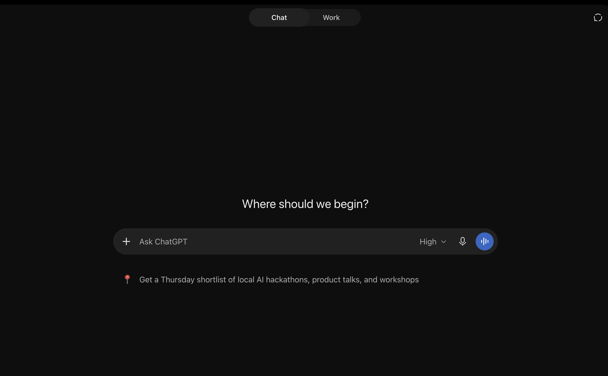
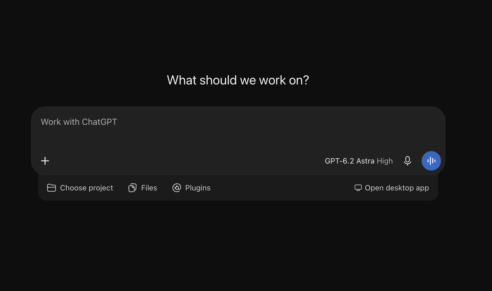
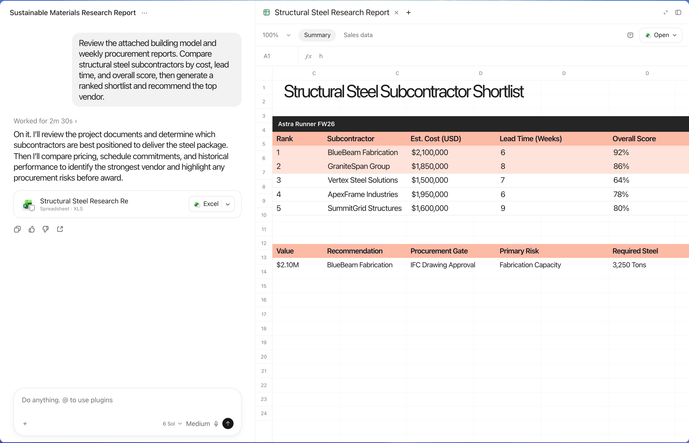

# Sự khác nhau giữa ChatGPT Chat, Work và Codex

Ắt hẳn bạn đã quen với việc hỏi đáp với GPT thông qua trang [ChatGPT.com](https://chatgpt.com). Nhưng bây giờ bạn muốn làm các tác vụ phức tạp hơn, ví dụ như là phát triển phần mềm, thì bạn sẽ sử dụng chế độ nào?

ChatGPT có 3 chế độ, **Chat**, **Work**, Và **Codex**.

Thú thực là mình thấy cách OpenAI chia chế độ hơi khó hiểu và nhiều lúc ranh giới giữa các chế độ cũng không rõ ràng lắm.

## Chat

Trong chế độ Chat, chúng ta chỉ có thể làm những tác vụ căn bản như nhắn tin, searchweb, tạo ảnh, xử lý tài liệu.

Giả dụ bạn đang mua hàng ở Shopee, ở chế độ chat thì cùng lắm bạn có thể bảo AI so sánh giá cả giữa những shop bạn đang xem và chọn ra một shop tốt nhất.

## Work

Ở chế độ work, chúng ta được tiếp xúc với agent thay vì một chat interface thông thường. Để mình lấy một ví dụ cho bạn dễ hiểu.

Qua chế độ Work, bạn vẫn có thể nhờ agent so sánh giá cả y chang như chế độ chat, nhưng ngoài ra bạn cũng có thể bảo agent mở link bạn vừa chọn ra và đặt hàng luôn cho bạn.

---

Nếu chat chỉ được dùng để trao đổi ý tưởng và brainstorm, thì work có thể thực hiện thay cho bạn một tác vụ bạn mong muốn.

---

Bạn có thể đọc tài liệu của OpenAI nếu bạn muốn hiểu sâu hơn: [https://learn.chatgpt.com/docs/use-chatgpt](https://learn.chatgpt.com/docs/use-chatgpt)
