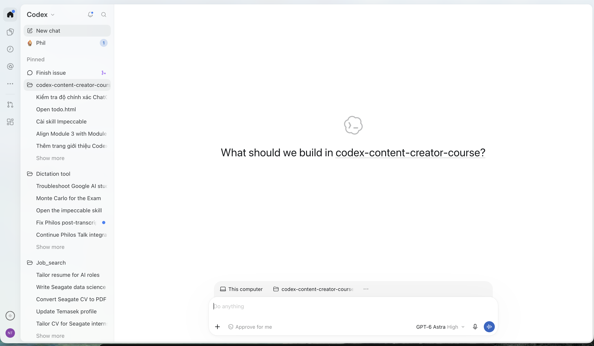

Cuối cùng là Codex, Codex có thể làm hầu hết những tác vụ mà chat và work làm, nhưng điểm khiến nó khác biệt là khả năng kiểm soát chi tiết kỹ thuật.

Quay lại ví dụ mua hàng online, nếu bạn thấy lười prompt cho agent shopping mỗi ngày quá, bạn có thể dùng Codex để tạo automation pipeline giúp agent tự động shopping mỗi ngày. Thậm chí bạn cũng có thể tạo hẳn một app để quản lý mua hàng và chi tiêu.

Với Codex, bạn có thể trực tiếp đọc code và sửa code.

Thú thực mình không dùng work nhiều lắm, vì đa số những điều mà work làm được thì Codex cũng làm được, và nó cho mình nhiều quyền kiểm soát kết quả đầu ra hơn.

Trong khóa học này chúng ta sẽ sử dụng Codex. Yên tâm là bạn không cần phải biết code đâu, vì bạn có thể prompt cho Codex làm hầu hết mọi tác vụ thay bạn. Bạn chỉ cần hiểu được cách để hoạt động với coding agents hiệu quả, điều mà mình sẽ chỉ cho bạn trong khoá học này.
